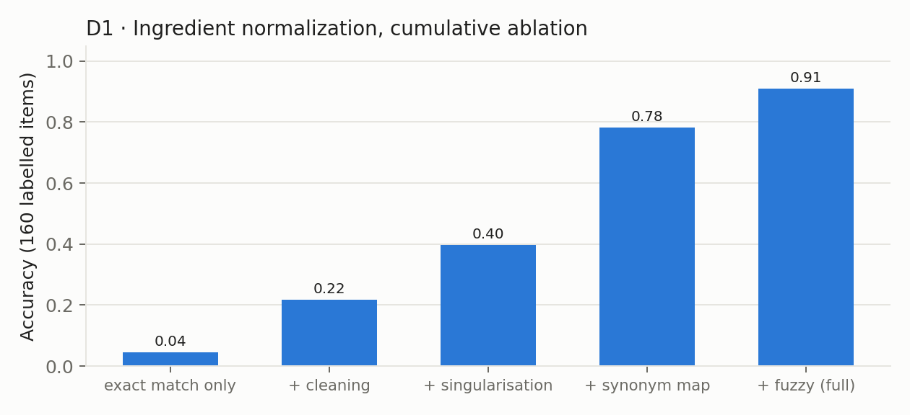
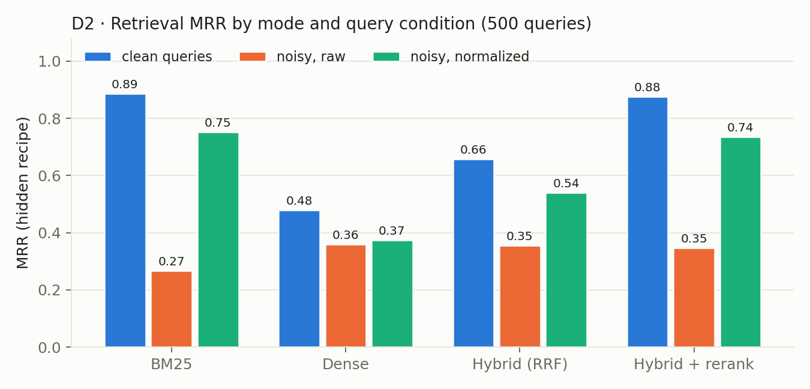
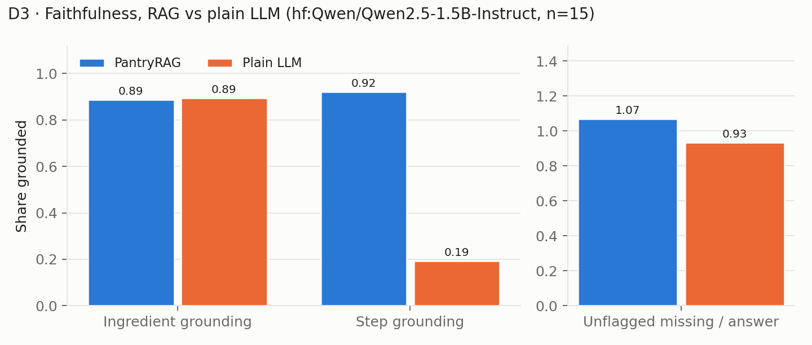

# PantryRAG

A pantry-based recipe chatbot using hybrid retrieval-augmented generation.
Computational Gastronomy mini-project, IIIT Delhi (Prof. Ganesh Bagler), Group 43:
Aditya Kantiwal (2023045) and Sahitya (2023464).

You type what's in your pantry ("I have paneer, spinach, rice, onion and tomato;
vegetarian, under 30 minutes"). PantryRAG answers with real recipes, cites their recipe
IDs, lists the ingredients you're missing, and suggests substitutions. Follow-up turns
refine the pantry and constraints ("make it vegan", "show me the second one").

```
free text ──► D1 pantry parser + normalizer ──► ingredients + constraints
                                                   │
          ┌──────────────── D2 ────────────────────┤
          │ BM25 (ingredient tokens)   dense (MiniLM)│   hard filters: diet, time,
          │            └── Reciprocal Rank Fusion ─┘│   calories, cuisine, exclusions
          │            coverage + pantry-use rerank  │
          └──────────────────────────────────────────┘
                                                   │ top-3 recipes + missing items
                     D3 substitutions (curated table + PPMI/name-similarity fallback)
                                                   │
                  D3 grounded LLM answer with [R<id>] citations (invalid IDs stripped)
                                                   │
                         D4 Streamlit multi-turn chat UI + evaluation
```

## Results

All numbers come from `results/*.json` and were produced by the scripts listed under
[Reproducing the evaluation](#reproducing-the-evaluation). The corpus is 9,878 BBC Good Food
recipes (see [Data](#data)).

**D1 · Ingredient normalization** (160 hand-labelled surface forms, `data/eval/normalization_gold.csv`)

| Stage (cumulative) | Accuracy |
|---|---|
| Exact match only | 4.5% |
| + cleaning (quantities, units, prep words) | 21.8% |
| + singularisation | 39.7% |
| + synonym map (Hindi / UK / US names) | 75.6% |
| **+ fuzzy matching (full)** | **91.0%** |
| Full pipeline without synonyms | 62.8% (user terms drop to 46.5%) |

Pantry-query parser on 25 full queries: ingredient F1 **0.95**, constraint-field accuracy **0.99**.

**D2 · Retrieval** (500 synthetic queries: hide a recipe, use 3–5 of its ingredients as the
pantry; rerank weights tuned on 200 separate dev queries)

| Method | R@1 | R@5 | R@10 | MRR | Top-5 pantry coverage |
|---|---|---|---|---|---|
| BM25 | 0.85 | 0.94 | 0.96 | 0.89 | 34% |
| Dense (MiniLM) | 0.40 | 0.57 | 0.62 | 0.48 | 30% |
| Hybrid (RRF) | 0.58 | 0.75 | 0.80 | 0.66 | 34% |
| **Hybrid + coverage rerank** | 0.83 | **0.94** | **0.97** | 0.88 | **41%** |

* On clean ingredient-list queries, plain RRF trails BM25. The coverage rerank brings recall back to
  BM25's level and raises pantry coverage from 34% to 41%, with fewer missing items (5.5 → 4.8).
* Writing documents for the dense encoder as ingredient lists only (no title or cuisine) took dense
  MRR from 0.26 to 0.48.
* Hard filters: without them, 55% of top-10 results break the query's diet or time rule; with them, 0%.

**D1 × D2 · Noisy pantry text** (same 500 queries rewritten with regional names, plurals,
typos and quantities, e.g. "makhan", "tomaot puree", "a handful of clam, diced")

| Method | R@5 raw | R@5 normalized | MRR raw | MRR normalized |
|---|---|---|---|---|
| BM25 | 0.31 | 0.82 | 0.27 | 0.75 |
| Dense | 0.43 | 0.46 | 0.36 | 0.37 |
| Hybrid + rerank | 0.45 | **0.85** | 0.35 | 0.74 |

On raw noisy text dense retrieval beats BM25; after normalization the full system recovers most of
its clean-query recall.

**D3 · Faithfulness, PantryRAG vs plain LLM** (15 pantry queries, the same Qwen2.5-1.5B-Instruct
model for both, `results/generations_hf.jsonl`)

| Metric | PantryRAG | Plain LLM |
|---|---|---|
| Steps grounded in a real recipe | **92%** | 19% |
| Ingredients grounded (plain scored against its best-matching corpus recipe) | 89% | 89% |
| Ingredients used but not disclosed as missing, per answer | 1.07 | 0.93 |
| Answers with a valid recipe-ID citation | 100% (7 invalid IDs auto-removed) | – |
| Diet violations | 0 | 0 |

The small 1.5B model sometimes drops items from the missing list it is given. The `extractive`
(no-LLM) generator always shows the full list.

**Other findings**
* Corpus ingredient names: the assignment's NER labels (95.6%) beat our rule-based phrase
  extractor (88.2%) on 68 gold recipe phrases, so the corpus keeps the NER names
  (`results/corpus_extraction.json`).
* float16 inference on Apple MPS made Qwen2.5 loop on long RAG prompts; `llm.py` uses float32 there.





## Quick start

```bash
python3 -m venv .venv
.venv/bin/pip install -r requirements.txt
```

Build the corpus and index (see [Data](#data) for where the CSV comes from):

```bash
.venv/bin/python scripts/import_bbc.py --dir /path/to/Group44_A1_CGAS/Q1
.venv/bin/python scripts/build_index.py --source bbc
```

Run the chat UI:

```bash
.venv/bin/python -m streamlit run app.py
```

Pick the generator in the sidebar. `extractive` needs no LLM and answers instantly. `hf` runs a local
Qwen2.5-1.5B-Instruct (about 3 GB, downloaded on first use). `anthropic` uses an API LLM and needs
`ANTHROPIC_API_KEY`.

Run the tests:

```bash
.venv/bin/python -m pytest -q tests
```

## Reproducing the evaluation

| Deliverable | Script | Output |
|---|---|---|
| D1 normalization accuracy + ablation, pantry parsing | `scripts/eval_normalization.py` | `results/normalization.json` |
| D2 BM25 vs dense vs hybrid vs hybrid+rerank | `scripts/eval_retrieval.py` | `results/retrieval.json` |
| D1×D2 noisy queries, with and without normalization | `scripts/eval_retrieval_noisy.py` | `results/retrieval_noisy.json` |
| D3 faithfulness, RAG vs plain LLM | `scripts/eval_generation.py --backend hf --n-synthetic 5 --limit 15` | `results/generation_hf.json` |
| D4 human evaluation sheet (blinded A/B) and scoring | `scripts/make_human_eval.py build` / `score` | `results/human_eval/` |
| D1 diet labels vs the site's diet tags | `scripts/eval_diet.py` (after `scrape_bbc.py`) | `results/diet_labels.json` |
| Figures | `scripts/make_figures.py` | `results/figures/` |

Hand-labelled data in `data/eval/`: `normalization_gold.csv` (160 surface forms: 90 recipe
phrases, 70 user terms) and `pantry_queries_gold.jsonl` (25 pantry queries with gold ingredients
and constraints).

## Data

* **Evaluation corpus: BBC Good Food, 10,000 recipes** scraped by the group for the course
  assignment (`recipes_raw.csv` with ingredient phrases, steps, cuisine, servings, prep time, plus
  NER ingredient names). The raw data is not redistributed here; `scripts/import_bbc.py` converts it
  to the corpus schema. This is the proposal's fallback-dataset route.
* **RecipeDB 2.0** (CoSyLab, IIIT Delhi) through the Foodoscope API (`pantryrag/recipedb.py`,
  `scripts/fetch_corpus.py`). `search-recipe/{id}` returns metadata, ingredients and steps in one
  call. Each API key's token balance ran out after about 200 calls, so the full pull could not finish;
  with a funded key, `fetch_corpus.py` then `build_index.py --source recipedb` switches the corpus.
* **Page enrichment** (`scripts/scrape_bbc.py`): fetches each recipe page's schema.org JSON-LD (total
  time, calories, cuisine, keywords, diet tags) and merges it by URL. It follows robots.txt: only
  `/recipes/` pages, a 12-second crawl delay, and a stop on 403/429. The site's content signal is
  `search=yes, ai-train=no`; PantryRAG builds a search index and trains no model on the text.
* RecipeDB's own diet flags were 0 even for clearly vegetarian dishes, so diet labels are derived
  from ingredients (`pantryrag/diet.py`).

## Repository layout

```
pantryrag/      recipedb.py (API client) · corpus.py · normalize.py · lexicon.py · pantry_parser.py
                diet.py · retrieval.py · substitutions.py · llm.py · generation.py · pipeline.py
scripts/        import_bbc · fetch_corpus · scrape_bbc · build_index · eval_* · make_human_eval · make_figures
app.py          Streamlit chat UI
data/eval/      hand-labelled gold sets
results/        metrics JSON, generations, figures
report/         method notes
tests/          unit tests
```
